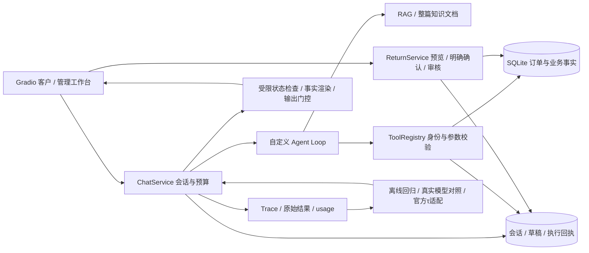

# 电商客服 Agent

一个围绕真实 Badcase 持续改进的客服 Agent 工程项目。使用 Python、自定义 Agent Loop、
Gradio、SQLite 和 RAG，将订单查询、退货草稿、明确确认、申请审核与结果查询连成可恢复流程。
重点是业务事实有来源、写操作有授权、失败有轨迹、改进有对照证据。

V1已完成交付；当前独立V2分支增加轻量业务路由、有限故障恢复、安全重启核对和客户可读进度。
[分阶段方案与验收](docs/PHASE_V2_PLAN_AND_ACCEPTANCE.md)记录范围与开销；机制仅覆盖有限请求，默认关闭，
本地 Demo 显式开启。[合并前可靠性验收](results/v2_premerge_20261022/REPORT.md)另存新边界、性能与小预算配对证据。
数据为合成场景，不提供真实退款、换货、订单修改或人工接管。

[五分钟 Demo](docs/DEMO.md) · [架构与证据](docs/DELIVERY_ARCHITECTURE.md) ·
[简历与面试材料](docs/INTERNSHIP_PROJECT.md) · [交付验收](results/project_handoff_babbfab/REPORT.md) ·
[范围](docs/PROJECT_SCOPE.md) · [PR 与合并计划](docs/PR_HANDOFF.md)

最新[阶段验收](docs/TAU_V21_STAGE_ACCEPTANCE_20261022.md)：原正式评测119/120已评分，最后1段预算阻塞；
V2.1独立真实8题配对4/8→3/8，没有证明整题质量提升。实验仍默认关闭，PR保持draft。
混合咨询有离线保留收益，但模型漏存订单级草稿仍是主要失败；不据少Token宣称更强。

2026-10-23只读交付审计：[实际架构/Memory/SSE](docs/CODE_ARCHITECTURE_AUDIT.md)、
[五批独立Evaluation Scorecard](docs/EVALUATION_SCORECARD.md)、
[源码关联面试说明](docs/AGENT_ENGINEERING_INTERVIEW.md)、
[最小修复优先级](docs/RELIABILITY_GAP_PRIORITIES.md)。集成f987474的CI为912 passed/4 skipped；
PR #4仍指旧V2，未将集成绿灯冒充已合并。

## 功能与职责

- **Agent Runtime**：手写 Function Calling 循环，工具参数校验、整轮预算、停止原因、
  逐次 usage 和可观察 Trace；ChatService 统一服务页面与评测，同一会话串行、最多两个活动轮次。
- **RAG 与工具**：BM25、Dense、RRF、可选 API 重排和证据核验；小知识库支持全文及整篇文档
  对照。订单、SKU、数量和物流来自 SQLite，政策与规格来自版本化知识文档。
- **状态化售后**：SQLite 持久会话、带来源的草稿及修订、更正与恢复；预览后由页面明确确认
  创建待审申请，管理员独立认证审核，用户只查询本人记录。事务、幂等和剩余数量约束在服务端。
- **有限可靠性保护**：补存遗漏的订单草稿、绑定订单商品事实、执行明确历史颜色限制、区分
  订单数/明细数/件数。受保护答案核验后才进入聊天正文，异常结果不生成权威统计。

自定义的是 Loop、业务状态协议、保护接入和评测适配；模型、Embedding、FAISS、Gradio
及官方 Benchmark 是集成能力。详细边界见[项目材料](docs/INTERNSHIP_PROJECT.md)。



## 快速启动

需要 Python 3.13、uv 和可用的 OpenAI 兼容模型服务。依赖版本锁定在 `uv.lock`。

```bash
uv sync --extra dev --frozen
# 首次配置，已有.env请保留。填入自己的模型Key，不提交该文件。
cp -n .env.example .env

# 终端一，先等客户入口启动完成
uv run python scripts/workbench.py --demo

# 终端二，与客户入口共用同一持久目录
uv run python scripts/workbench.py --demo --admin
```

客户入口 http://127.0.0.1:7860，管理入口 http://127.0.0.1:7861。Ctrl+C 停止。
默认演示目录 `~/.local/share/ecommerce-agent/workbench-v2`，不存在才生成，重启保留申请和会话。
可用 `--scenario /新的绝对路径 --port 7862` 指定隔离数据和端口；两入口必须使用同一场景。

`--demo` 只对当前进程显式开启原四保护及V2路由/恢复/进度，不修改 `.env`。管理员配置为空时使用文档明确标注的
本机合成演示账号，详见 [Demo](docs/DEMO.md)。不加 `--demo` 遵循原配置，四开关默认 false。
**发送真实对话会调用付费模型**；页面历史回放和脚本模型验收不收费。

V2代码新增独立反馈表并迁移至SQLite v6。升级前停服务备份，演示建议新场景目录；
回退V1需恢复升级前副本，不能直接用V1写v6库。详见[Demo](docs/DEMO.md)。

v2 演示使用 `get_knowledge_documents` 选择整篇版本化文档，无需 Embedding Key 或建索引；
它不是向量检索演示。原始按需 RAG 入口为 `uv run python app.py`，需要原业务库和匹配索引。
初始化和索引构建命令见 [运行说明](docs/DEPLOYMENT.md)，请在新隔离路径运行，避免重建已有数据。

## 可复核的结果

| 证据类型 | 实际结果 | 解释与限制 |
| --- | --- | --- |
| 工具调用优化 | 35 题各 3 次，调用 160→122，少 23.8%；统一 v4 严格判据 63.8%→95.2% | 同一已见开发集；包含事实/评分修正与提示改动，平均 Token 多 4.2%，不宣称总体提速。[原始对照](results/tool_efficiency/comparison.json) |
| 多轮业务评价 | 历史 80 段两次共 320 段，前后均 140/160；新增开发 34/48→37/48，验证 22/24→23/24 | 状态与语义均须通过；未判定单列，作者知道任务，不是客户盲测。[完整报告](results/iteration_v2_recovery/final/REPORT.md) |
| 官方τ零售 | 114 题×3 次×2 臂，共 684 段；项目 Loop pass^1 86.5%、pass^3 78.9%；官方同模型 87.4%、75.4% | 保留官方数据、政策、工具、模拟器和评分；不换成本店商品，不代表本地全业务成功率，内部预算不完全一致。[摘要与冻结条件](results/iteration_v2_recovery/tau_base/summary.json) |
| V1 真实 DeepSeek | 11 个固定已见任务每臂 1 次，任务 6/11→11/11；58 请求、280628 Token，费用估算 0.143 元 | 五个同次生成错误原答被纠正，无稳定因果或总体成功率结论；最终源码另有 22 段离线重放。[分析](results/final_delivery_c9afdbf/live/analysis.json) |
| 工程验收 | 完整离线测试、真实 Gradio 页面业务链路及异常帧检查 | 脚本注错不等于真实模型成功率；最新本轮结果见[交付报告](results/project_handoff_babbfab/REPORT.md)。[上一阶段 695 项通过](results/final_delivery_c9afdbf/full_pytest_clean_environment.log) |

外部新增固定 Pilot：官方/V1/V2 三组各三题一次均 **3/3**，共132请求、503,612 Token，
保守记账2.126384元（独立5元授权）。V2的13次路由均fallback，自然重试为0，
不据此宣称Router或普通任务质量提升。[适配、逐例结果与限制](docs/EXTERNAL_BENCHMARK_V2_REPORT.md)。
完整历史τ分数保持原口径。新增40题三臂正式对照经获批断点补充后 **119/120段已评分**：
Official 35/40、V1 36/40；V2 35/39，task111因费用预留不足未评分，不报告完整V2 pass^1或新的pass^3。
相同39题V1/V2逐题结果一致；V2输入Token多2.49%，无合法路由收窄、无自然恢复，未证明更强或更省。
累计2000请求，保守39.840192/40元（含原未知usage全额预留）；供应商已知usage估算3.369738元，非账单。
[正式报告、逐题结果与失败原因](docs/EXTERNAL_BENCHMARK_V2_FORMAL_REPORT.md)。

原始失败、原评分和冻结结果均保留。最新真实对照的逐例复核由编码助手按冻结契约完成，
未经独立外部人工盲审；同供应商语义裁判也有误判。数字说明特定实验，不能互相替代。
四开关开启不增加审查模型调用，但会增加部分后续上下文，并延迟受保护请求的首个回答文字。

V2 新冻结配对：8个自然任务两臂均8/8；2个受控503任务0/2→2/2。自然输入Token少11.06%，
模型请求21→21，费用和延迟未证实改善；不能表述为一般成功率提升。
[完整原始记录与限制](results/v2_premerge_20261022/REPORT.md)。

## 复现与自动检查

```bash
uv run pytest
uv run ruff check .
uv run python scripts/check_secrets.py --all-tracked
```

[GitHub Actions](.github/workflows/offline.yml)在无模型密钥环境安装锁定依赖并执行上述检查，
可选 tau2 缺失时跳过。最新运行状态和源码提交对应关系见[交付报告](results/project_handoff_babbfab/REPORT.md)。
无网络预演、真实决策重放、浏览器验收和录制入口见 [Demo](docs/DEMO.md)。
大规模真实模型或 Benchmark 命令会收费，不属于普通测试或启动流程。

## 目录与阅读顺序

```text
src/acs/       Runtime、工具、RAG、会话、业务服务、评分与适配
app.py         客户Gradio工作台
admin_app.py   独立认证审核工作台
scripts/       初始化、启动、评测、验收与密钥检查
data/         合成数据定义、知识文档与冻结任务
tests/        无模型密钥回归测试
results/      原始实验、冻结清单、失败、截图与报告
docs/         架构、范围、问题记录、运行与面试材料
```

先看 [Demo](docs/DEMO.md)，再读 [架构](docs/DELIVERY_ARCHITECTURE.md)、
[三个 Badcase 与面试讲解](docs/INTERNSHIP_PROJECT.md)、[问题解决记录](docs/PROBLEM_SOLVING.md)。
完整历史条件保存在 [EXPERIMENT_LOG](docs/EXPERIMENT_LOG.md)，
[ECom-Bench 静态分析](docs/ECOM_BENCH_COMPATIBILITY.md)说明为何没有为得分扩大业务范围。

[正式评测恢复与 V2.1 验收](docs/TAU_FORMAL_RECOVERY_AND_V21_PLAN.md)保留原102段时点的恢复方案；
后续已补17段评分，当前119/120，最后1段预算停止，不能重复使用旧18段启动命令。

## 已知限制与交付状态

本项目适合本机合成数据演示与 Agent 工程实习讲解，尚不具备生产级可靠性。
客户身份是模拟用户选择，后台管理员才有认证；不要直接开放为公网客服服务。
有限规则不理解任意同义表达、时间过滤、混合诉求或隐含统计范围；未接管自由文本仍可能编造，
历史 S20009 附注错误尚未通用修复。开启对应保护后，无完整回执会提示未核实；未保护的自由回答仍有虚报风险，保护也可能降低任务完成度。

四个实验开关默认关闭，见 `.env.example`；不自动合并 main，不修改可见性，不重复跑完整τ。
仓库的许可证、历史大文件和公开前检查建议见 [PUBLICATION_READINESS](docs/PUBLICATION_READINESS.md)。
源码检查不能证明不存在一切秘密或隐私，公开或授权方式须由维护者决定。


V2.1受限混合回答在[独立离线验收](results/v21_mixed_answers_20261022/REPORT.md)中保留操作回执，
另列可信政策/商品资料：24个已见固定决定的咨询事实满足0→17、冻结安全契约0→14（非用户整题成功），已覆盖错误帧0→0，
模型调用45→45，后续输入增加582.25字符。不是自然模型成功率；默认关闭，复杂订单咨询未覆盖。
