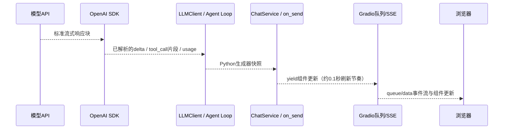

# 电商客服 Agent 架构与实现审计

核验日期：2026-10-23（Asia/Shanghai）。源码基点 `f987474`，本轮仅新增文档和只读派生证据。
[远端/PR/依赖取证](../results/project_audit_20261023/repo_state.json) ·
[统一指标](EVALUATION_SCORECARD.md) · [面试说明](AGENT_ENGINEERING_INTERVIEW.md) ·
[后续缺口](RELIABILITY_GAP_PRIORITIES.md)。

## 实际版本和未完成事项

| 对象 | 实际SHA | 核验结论 |
| --- | --- | --- |
| 远端main/V1 | `f34981fa1324310a9d0f0de4430fe1980ba664e9` | 已合并V1，不含完整V2/V2.1 |
| PR #4 / feat/runtime-v2 | `f6c3387c81e71022b96d553bd080f5751198b6f9` | OPEN、draft、base main；仍是旧V2 |
| integrate/runtime-v21-delivery | `f987474fff47c0f65ca3911fcd09393a352f382d` | 已推送，父提交f780f17和c12bb62，包含整合代码与证据 |
| 原正式补充 | `f780f17` | 102旧结果跳过、新增17评分，累计119/120 |
| V2.1混合回答 | `c12bb62` | 原V2.1修复及受限咨询呈现；不能冒充原V2官方成绩 |

集成提交[CI 39787694111](https://github.com/qingtian-4/ecommerce-agent/actions/runs/39787694111)
实际为 **912 passed、4 skipped、7 warnings**，Ruff及密钥检查通过。
[摘录](../results/project_audit_20261023/ci_excerpt.log)来自远端日志，不是本轮重新运行912项。
PR #4的绿灯对应旧f6c3387，不能替代集成CI；上一轮尚未同步PR头。当前只读整理不擅自更新头或合并。
本地main引用仍可能过期，审计以读取到的远端main为准。主工作树在恢复分支且有三项用户修改，
本轮不覆盖；文档在原本干净的集成工作树完成。

## 已有能力、实验能力和缺口

| 层 | 当前实现/源码入口 | 能力状态与边界 |
| --- | --- | --- |
| Agent Loop | [CustomerServiceAgent._run_turn](../src/acs/service_agent.py#L243) | 已有工具决策循环、参数/回执入上下文、预算与停止原因；不是多Agent或通用图执行器 |
| ChatService | [run_turn](../src/acs/chat_service.py#L55) | 已有会话归属、全轮预算、恢复上下文和最终状态同步；进程内活动轮次上限2，不是分布式限流 |
| 会话持久化 | [SessionStore.load/begin_turn/finish_turn](../src/acs/sessions.py#L182) | SQLite事务、每会话至多一个running轮、完整工具消息配对；只保存不等于回答正确 |
| 售后工作流 | [ReturnService.preview/confirm_and_submit/review](../src/acs/returns.py#L115) | 已有草稿→预览→页面确认→待审→通过/拒绝；实际退款、实物换货、订单改址和实时人工未实现 |
| RAG | [KnowledgeBase](../src/acs/rag.py#L134)、[knowledge_context](../src/acs/knowledge_context.py) | 已有BM25、Dense/FAISS、RRF、可选重排/证据核验；整篇documents和full_context是另外两条知识获取路径 |
| Router | [route_request](../src/acs/routing.py#L17) | 实验；本地词法范围与混合意图并集，不确定回退；没有独立售前/物流/售后模型实例 |
| Recovery | [classify_failure/reconcile_update](../src/acs/recovery.py#L21)、[recover_interrupted](../src/acs/sessions.py#L323) | 实验增强；有限无文本前重试、未知写读回、重启核对；没有自动从任意中间节点恢复 |
| 事实保护 | [return_state_check](../src/acs/return_state_check.py)、[order_candidates](../src/acs/order_candidates.py)、[order_reliability](../src/acs/order_reliability.py) | P0/P1/颜色/聚合均已有但默认关闭；有限问法、完整工具结果及身份验证才适用 |
| 写回执和混合咨询 | [write_evidence](../src/acs/write_evidence.py)、[consultation_reply](../src/acs/consultation.py#L15) | V2.1默认关闭；回执绑定对象/字段，咨询另列，未知写不重放；复杂订单咨询不受通用保护 |
| Gradio展示 | [on_send](../app.py#L574)、[build_app](../app.py#L1104)、[progress_events](../src/acs/progress.py#L73) | 已有生成器刷新、工具Trace、可观察进度；进度为事件投影，不是隐藏CoT |
| 外部τ适配 | [ACSAgent/OfficialRegistry](../scripts/tau_acs_agent.py) | 复用官方合成商品/政策/工具/用户/评分；不替换成本店耳机数据；不走本店ChatService/ReturnService/UI/RAG |

默认配置：`return_state_check`、`order_candidate_render`、`order_constraint`、`order_aggregation`、
`workflow_router`、`runtime_recovery`、`execution_progress`、`write_receipt_guard`共八个enabled字段均false，
见[Settings](../src/acs/config.py#L142)。默认已有后端权限、取消授权、预览确认和幂等并不因关实验而取消。
`--demo`显式开启的开关以[workbench入口](../scripts/workbench.py)为准，不能假定也开启V2.1写回执；
[混合页面脚本](../scripts/check_v21_mixed_ui.py)是独立显式配置，强制空Key和脚本模型。

## Context、持久会话、业务State、长期记忆

| 概念 | 本项目实际载体 | 生命周期/权威性 |
| --- | --- | --- |
| 短期模型Context | agent.messages；ChatService组织system/历史/草稿；bounded_context/model_context裁剪 | 每次请求有限字符窗口，含旧工具结果，不保证模型遵从或数据仍新鲜 |
| 会话持久化 | conversations/conversation_turns中的user_text、messages_json、result_json、answer | 跨刷新/重启恢复同用户会话；不是自动跨会话语义检索或用户画像 |
| 业务任务State | return_tasks中的order_id/item_id/quantity/reason、status、revision、sources | 可只有订单而没有商品。sources是当前原话/turn和用户声明来源，不是资格认证或Fact Ledger |
| 权威业务记录 | orders/order_items/SKU、return_requests/reviews/confirmations | 当前事实和实际副作用；资格/状态变化须重新查询，不能用模型文本代替 |
| 颜色约束状态 | color_constraint对完整归属用户历史的有限规则投影 | 在模型裁剪前重建，明确更正/取消、未知表达暂停；不是通用长期Memory |
| 长期记忆 | 未实现 | 无跨会话偏好学习、语义记忆检索、自动摘要记忆库或长期自我改进 |

源码：[ChatService上下文组织](../src/acs/chat_service.py#L125)、
[context.py](../src/acs/context.py)、[字段来源和修订](../src/acs/sessions.py#L379)、
[color_constraint](../src/acs/order_reliability.py#L15)。RAG的版本化政策/规格是知识库，不等同于用户记忆。
D01/D02中订单工具已返回，模型却等待商品明细而没调草稿工具，不能无证据归因Memory丢失。

## 流式输出和SSE究竟是谁实现的

[LLMClient.chat_stream](../src/acs/llm.py#L195)调用SDK `stream=True`，累计tool_call参数直到完整响应，
在finally记usage并关闭流；缺finish_reason报中断。底层SSE解析由OpenAI SDK承担。
[_async_chat](../src/acs/llm.py#L255)和[iterate_request](../src/acs/async_transport.py#L19)
是自写的异步I/O到同步生成器桥接：线程/队列传块、wait_for限定总请求时间、关闭时取消Task。
这不是自研SSE线协议，也不是分布式任务队列。

[app.py事件绑定](../app.py#L1445)使用Gradio `.then(on_send, stream_every=0.1, concurrency_limit=None)`；
页面传输/队列/序列化由Gradio提供。本次锁定安装为Gradio6.29.1、OpenAI3.26.0；
实际Gradio `routes.py::queue_data/queue_data_helper`用`StreamingResponse(..., media_type='text/event-stream')`。
[依赖源码路径、版本、哈希](../results/project_audit_20261023/repo_state.json)和[uv.lock](../uv.lock)可复核。
不能声称自己编写了SSE服务器、事件重连协议、浏览器网络栈或FastAPI业务服务。

写回执开关开启时Loop先缓冲模型文字；ChatService另对订单事实/取消/未知写做输出门控。
工具和进度仍可展示，最后回答/历史/final Trace同步。不承诺撤回已显示内容；普通未保护路径仍可先露错。
真实8题可见首答p50为1.10→3.92秒，说明保护存在展示延迟代价，不能只报端到端均值。

## 权限、事务和恢复的实际边界

ToolRegistry.run过滤模型传入身份字段，数据层按应用user_id查询；Router的工具白名单不是授权。
模型没有正式提交/审核工具；页面确认和认证管理员调用ReturnService。
预览绑定revision、政策hash和10分钟有效期，提交在BEGIN IMMEDIATE内重验业务与材料，并按preview_id幂等返回。
不是网络分布式exactly-once承诺；未知写须核查实际状态，不能盲重放。

SessionStore.finish_turn验证完整消息配对和最后assistant等于result.answer；它本身不是通用事实裁判，
final Trace同步由ChatService和测试保证。默认启动会标记旧running为interrupted；Recovery开时再读权威状态，
**不会续跑原工具或模型节点**。recover_interrupted要求单客户服务启动，不提供多worker租约/领导选举。
本地客户为模拟身份，后台才有认证；不适合直接公网生产。

## 本轮发现和交付判断

确认保留：PR头未同步、正式V2/task111未评分、漏存订单级草稿、混合取消误拦截、
自由说明不受通用校验、离线“14/24”不能当用户任务成功数。没有为这些问题在本轮改业务代码。
已有RAG相关性核验可能增加LLM调用（_verify_evidence），可选重排也有成本；不能宣称所有回答只调用一次模型。
原τ正常任务没有自然Recovery重试，固定故障测试能证明故障路径接线，不能替代自然收益。

实习项目的代码/证据/合成Demo可展示；默认开启、生产可靠、完整120段成绩及“V2.1比V2强”仍No-Go。
后续最小修复和对应测试见[优先级表](RELIABILITY_GAP_PRIORITIES.md)，先经维护者决定。
