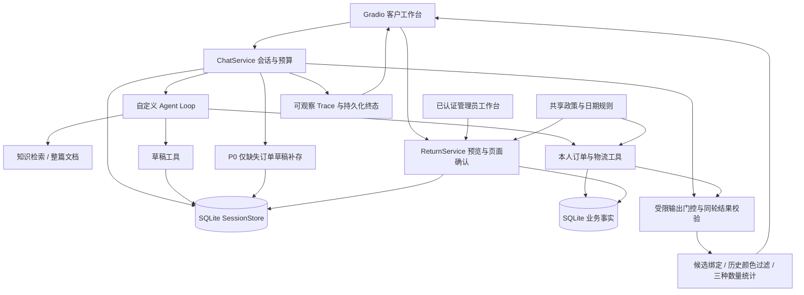

# 电商客服 Agent 架构与证据

这是当前源码的职责图，业务执行仍由现有自定义Loop、SQLite和ReturnService完成。
四个实验保护开关默认关闭；`scripts/workbench.py --demo`只对当前进程显式开启。

商品、政策来自知识库；订单、SKU、数量、物流及申请状态来自业务SQL和执行回执。
`return_rules.py`只解析政策和日期，不依赖会话或ReturnService，避免循环依赖。
查询中的窗口标志是日期初筛；资格仍需要原因、状态、剩余数量、材料与预览/提交复核。

模型选择工具；Runtime不自动选择退货明细或创建申请。P0只在当前用户明确表达、
同轮成功查询本人订单且草稿不存在时补存订单。取消草稿使用当前原话的明确授权，
在原有事务与身份检查内判定；否定、引用、假设、暂停等不产生破坏性写入。

完整结果校验由`order_candidates.order_lookup_result`统一负责，三个展示机制复用。
它拒绝异常包络、count不符、重复ID和不可信部分结果，不新增查询或写入。
输出门控只覆盖可识别保护请求；核验前聊天区域不展示模型结论，工具进度仍可见。
完成后同步answer、assistant message、final Trace及数据库；诊断轨迹保留并标注原答。
这不是通用事实审查，未受保护的自由文本仍可能出错。

## 复现与证据入口

| 证据 | 入口 | 能说明什么 |
| --- | --- | --- |
| 当前阶段验收 | [REPORT](../results/final_delivery_c9afdbf/REPORT.md) | F1–F6、线上/离线界限、费用与交付决策 |
| 红测试 | [red.log](../results/final_delivery_c9afdbf/red.log) | 修复前真实实现未满足新安全契约 |
| 真实对照 | [analysis.json](../results/final_delivery_c9afdbf/live/analysis.json) | 11题每臂一次，真实请求、人工按冻结契约核对 |
| 在线源码快照 | [manifest](../results/final_delivery_c9afdbf/live/manifest.json) | 调用时未提交源码哈希与配置，不能只用HEAD代表 |
| 最终代码重放 | [final_replay](../results/final_delivery_c9afdbf/final_replay/summary.json) | 22段记录决策在最终源码上回答一致，零网络 |
| Gradio全流程 | [browser_styled](../results/final_delivery_c9afdbf/browser_styled/summary.json) | 实际页面与CSS、脚本模型、真实SQLite业务执行 |
| 异常页面帧 | [browser_faults](../results/final_delivery_c9afdbf/browser_faults/summary.json) | 无工具、断流、超时与刷新恢复，非模型成功率 |
| 裁判校准 | [paired.json](../results/final_delivery_c9afdbf/judge_calibration/paired.json) | 解析取证与工具回执判断，未做付费语义裁判复验 |
| 历史τ对照 | [原报告](../results/iteration_v2_recovery/final/REPORT.md) | 官方环境中的Loop能力，非本店全业务成功率；本轮未重跑 |
| ECom静态兼容 | [分析](ECOM_BENCH_COMPATIBILITY.md) | 固定上游53题工具/评分差异，未开发或运行Adapter |

## 已知限制

仅支持已验证的有限表达：历史颜色限制的白/黑/蓝色及明确更正、取消，首轮显式统计范围。
时间同义表达、隐含范围、复合诉求、未知更正将退出；不是通用意图系统。
缺少有效完整工具结果时返回未核实提示，不把原自由文本视为已验证。
需要增加覆盖时，先冻结正反例及误拦截指标，不继续堆提示或无限追加正则。

本轮真实对照为已见开发/回归任务、每臂一次。结果支持有限路径Demo，不支持总体成功率、
稳定因果收益、默认启用或生产上线承诺。原模型S20009自由附注的错误仍未被通用治理。
管理员通过只意味着申请允许退回，不执行退款、换货或实时人工接管。
