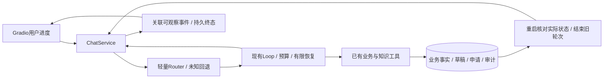

# 电商客服 Agent V2 方案与阶段验收

日期2026-10-21，V1完整基线`35008f725eb19f2fa938f09702004a5baeaa9163`，
文件树与已验收`3556eff`一致。独立分支`feat/runtime-v2`，不修改用户TODO/技能文件/附加标记。
附件V2 Prompt及本轮用户的三个取舍是实施范围；取代上一轮“停止增加功能”的阶段安排。

## V1审计与整合

PR #1已于2026-10-21合入main，main为`7ae7b3a`；PR #2合入P0分支，
该分支为`35008f7`，因此P1及最终V1没有完整进入main。已准备/创建V1整合PR，
head为`fix/order-draft-integrity`、base为main：[PR #3](https://github.com/qingtian-4/ecommerce-agent/pull/3)，OPEN且MERGEABLE；35008f7 CI成功。
V2从完整V1分支，不从只有P0的main开工，不自动合并。

| 已有模块 | 已具备 | 本轮补充 |
| --- | --- | --- |
| service_agent / runtime | 工具配对、预算、停止、用量和Trace；SDK不暗重试 | 受限路由工具范围、受控模型重试、无进展检测 |
| ChatService | 流式、两槽排队、上下文裁剪、P0/P1保护与终态落库 | 路由接入、错误/状态核对与关联事件 |
| ToolRegistry | 参数、用户身份、业务权限；没有提交/审核模型工具 | 执行范围受Router约束，原业务权限不变 |
| SessionStore / ReturnService | revision来源、事务、确认、幂等、审计、未完成轮次中断 | 真进程终止证据；重启先读权威回执，安全结束旧轮次 |
| RAG | BM25/Dense/RRF、文档模式、来源和统计 | 复用，不重写或付费建索引 |
| Gradio客户/管理页 | 三栏、草稿/预览/确认/审核、原始开发Trace | 客户可读进度与证据，详细JSON只留开发区；无CoT |

## 方案选择与回退

选择A：现有Loop+轻量Router。明确请求确定性分流、混合取并集，未知/否定/引述回退全工具；
不新建售前/物流/售后/Supervisor模型。路由不等于授权，写操作仍由原后台验证。

B LangGraph的检查点有助于节点恢复，但持久化不自动保证业务副作用恰好一次。
[官方持久执行说明](https://github.com/langchain-ai/docs/blob/main/src/oss/langgraph/functional-api.mdx)
同样要求任务幂等；当前事务和服务都已实现，迁移会增加上下文、工具消息及测试改造成本。
C 在现有Loop外套其他Agent框架也有相同迁移成本；本轮不增加依赖。
需求若发展为跨进程长期编排，再用实际失败证据重估，不以框架名称当能力。

本轮涉及超过8个文件，按四个独立可运行阶段交付。无数据库重置；不自动更新原四保护默认false。
新Router/恢复/进度可单独关闭，保持V1对照。新开关与事件结构在对应提交中记录。

## 分阶段验收

1. **Router**：售前、订单、物流、售后、价保、混合、未知；冻结否定/引用/更正/跨单插问。
   只收窄高置信工具集合，越范围工具不得执行；不增加模型分类调用，不清空或切换草稿。
   对照关闭/开启的实际工具执行、schema字符、任务状态、误拦截与路由耗时。
2. **Failure Recovery**：统一错误分类与动作；只对模型在未展示片段、未收到完整决策前的
   临时错误有限重试，所有实际请求仍走原RunBudget和usage。流式部分响应、业务拒绝、写操作
   不自动重放。429/503/网络/超时退避遵循Retry-After且不得越预算。连续相同工具/规范参数/
   结果无变化达到阈值才停止，正常换订单/结果变化不误判。读回写入真实状态，不明则标未核实。
3. **Crash Recovery**：子进程在接收、模型决策、查询、草稿、预览、提交、审核和流式阶段
   强制退出，父进程重启核查；未完成轮次interrupted，不回放写操作，不重复申请/审核。
   优先复用turn/草稿/preview/request/audit，不能证明需要时不新增通用检查点或调度表。
4. **UI**：事件从真实route/tool/retry/状态回执机械生成，绑定session/turn/seq。
   客户看进度和可核对状态，开发者看Trace；不输出隐藏CoT、系统Prompt、密钥。
   桌面/移动、正常/重试/拒绝/断流/刷新/恢复、候选选择/确认/审核有实际页面证据。
   用户反馈独立存储供复盘，不改知识或Prompt；若需表变更在UI阶段最小追加迁移。

阶段间先定向测试、相关回归和Ruff，再提交推送；最终跑完整pytest/密钥/CI。
每次输出目录独立，失败不删、不选择性重试成功样本。脚本usage不是实际Token/费用。
无新付费API或完整Benchmark，保持V1实验与main不变；高风险未解决时停该项而非绕过约束。

## 验收记录

- Phase 0：分支、PR与V1基线已核查；原始证据冻结在`results/phase_v2/freeze.json`。
- 其余阶段在通过实际测试后逐项追加结果，不预写成功。

## 剩余技术债分级

P0（生产前）：客户认证、隐私脱敏、监控告警/备份/回滚、写入状态不确定时的人工核对。
本机模拟身份不包装成生产认证。
P1：有限自然语言覆盖、自由附注事实、独立语义裁判、未见验证集、真实恢复成本测量、
动态政策与工具描述漂移、单机崩溃范围；本轮给离线证据，不声称真实模型收益。
P2：真实人工工单闭环、审核后的知识反馈、多实例SQLite压力、分布式限流、节点级自动续跑。
这些未被当前小规模需求证明必要，不随本轮默认实现。

### Phase 1：轻量Router已验收

冻结24条作者编写的开发表达，分类24/24；不等于通用意图准确率。正反例包含混合、否定、引用、
跨单插问及更正。正式红测试因缺Router模块失败，首轮实现两项分类失败也保留；修复后相关回归
213 passed，260.72秒，Ruff通过。现有任务在物流插问后逐字段不变，路由不替代授权。

同固定模型决策离线配对：两臂均2次模型调用，关闭执行get_product+get_order，开启仅执行get_order，
无关工具1→0；首轮工具schema字符3585→530，无新增分类模型或业务写入。2400次路由微测
p50约0.0033ms、p95约0.0046ms；仅纯路由函数，不是端到端延迟。脚本usage不当真实Token。
证据`results/phase_v2/router_probe.json`、`router_regression.log`；开关
`ACS_WORKFLOW_ROUTER_ENABLED=false`，关闭后保持V1工具集合。陌生/否定/引述回退全工具，
精确业务执行仍由Loop选择，高置信工具范围在schema和实际执行两处约束。

### Phase 2：有限恢复与终止已验收

新增`runtime_recovery_enabled=false`，瞬时错误最多额外1次（可设0至2），无进展阈值默认3。
重试只作用于模型未产生片段/完整决策的传输请求；工具不自动重试，已执行写操作不重放。
Retry-After秒数/日期与指数退避加抖动受整轮剩余时间限制，超过剩余预算不等待；
429/503/连接/超时可重试，参数/权限/业务拒绝/损坏/空或截断响应不自动重试。

| 错误 | 恢复动作 | 终态或继续条件 |
| --- | --- | --- |
| 429、临时5xx、连接、超时 | 未显示片段才有限重试，usage和API预算照常累计 | answered或retry_exhausted；预算优先 |
| 部分流式后异常 | 不重播文字、不再调模型 | llm_error，明确未完成 |
| 参数/不存在对象/权限/规则拒绝 | 交模型澄清或据证据回答，不自动重试 | 原权限与事务决定，不写假成功 |
| 损坏、空或截断响应 | 停止而非当完整回答 | llm_error并记录invalid_response |
| 连续工具+规范参数+回执均相同 | 3次才提前停止；对象/结果改变重新计数 | no_progress；仍补全批次工具配对 |
| 草稿/取消/预览响应异常 | 读取实际任务，不重新执行写操作 | tool_error已核对，或state_uncertain待核实 |
| 预算/上下文耗尽 | 不再请求或等待 | 复用budget_exceeded/context_limit |

初始红测试缺恢复模块；另两项红测试真实复现“已提交写入却展示模型退款成功”。修复后定向20通过，
相关97通过，Ruff通过；一次测试选择路径错误也保留日志，不算产品失败。实际LLMClient注入429证明
失败与成功两请求均计入usage，未知用量标记partial，隐藏思维内容不进入Trace。

固定故障配对见`results/phase_v2/recovery_probe.json`：瞬时故障1次失败→2次恢复，部分文本两臂均不重试；
持续故障最多2次后retry_exhausted；无进展6次工具→3次停止，交替对象不触发。均为离线固定故障，
不是供应商真实恢复率或真实Token，重复读取阈值也不能证明理解用户任意循环需求。
写入响应丢失只执行1次，revision=1；读回失败显示未核实，不退款、不自动申请。
原V1完整基线695 passed、1 skipped，502.69秒；阶段间并行运行受本机负载影响，不当性能比较。

### Phase 3：安全重启恢复已验收

新增的是权威状态核对，不是工作流节点重放。复用conversation_turns、return_tasks、preview、
request和review/audit，未增加恢复表或迁移；`recover_interrupted(reconcile=False)`可对照旧行为。
启动时仍只运行一次，不能在每次请求或第二个活跃进程中用它清理轮次。

独立子进程用os._exit(91)真正终止：收到请求、模型已返回调用但未执行、订单读完、草稿写入、
预览生成、确认提交事务前/后、审核事务前/后、流式部分输出，共10个边界。
提交前/审核前的Connection.__exit__注入在真实业务事务提交前退出，提交后先真实commit再退出。
恢复不回放模型或工具，保留草稿与合法业务状态，申请最多1条、审核最多1条、原数量约束不变。
模型决策和流式边界实际执行脚本Loop，不是只写“已模拟崩溃”标记。

10项原实现红测试均缺少可追溯权威恢复信息；新11项含关闭对照通过，23.90秒；会话/确认/审核
相关74 passed、4 warnings，117.29秒，Ruff通过。原V1本身已有事务和中断恢复，不能把新的
状态说明改善宣称业务去重从0提升到100%。未完成历史不保留孤立tool_call，不把旧轮次说成完成。
恢复结果保留request ID、实际状态及replayed=false，查不到就不假装本次已提交。
证据`tests/test_crash_recovery_v2.py`、`results/phase_v2/crash_*.log`。
