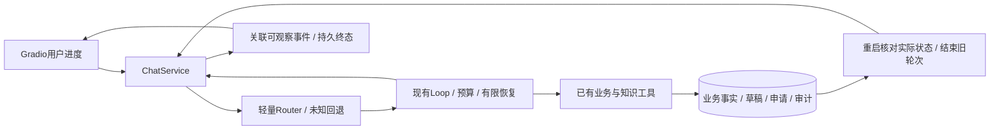

# 电商客服 Agent V2 方案与阶段验收

日期2026-10-21，V1完整基线`35008f725eb19f2fa938f09702004a5baeaa9163`，
文件树与已验收`3556eff`一致。独立分支`feat/runtime-v2`，不修改用户TODO/技能文件/附加标记。
附件V2 Prompt及本轮用户的三个取舍是实施范围；取代上一轮“停止增加功能”的阶段安排。

## V1审计与整合

PR #1已于2026-10-21合入main，main为`7ae7b3a`；PR #2合入P0分支，
该分支为`35008f7`，因此P1及最终V1没有完整进入main。已准备/创建V1整合PR，
head为`fix/order-draft-integrity`、base为main：[PR #3](https://github.com/qingtian-4/ecommerce-agent/pull/3)，OPEN且MERGEABLE；35008f7 CI成功。
V2从完整V1分支，不从只有P0的main开工，不自动合并。

| 已有模块 | 已具备 | 本轮补充 |
| --- | --- | --- |
| service_agent / runtime | 工具配对、预算、停止、用量和Trace；SDK不暗重试 | 受限路由工具范围、受控模型重试、无进展检测 |
| ChatService | 流式、两槽排队、上下文裁剪、P0/P1保护与终态落库 | 路由接入、错误/状态核对与关联事件 |
| ToolRegistry | 参数、用户身份、业务权限；没有提交/审核模型工具 | 执行范围受Router约束，原业务权限不变 |
| SessionStore / ReturnService | revision来源、事务、确认、幂等、审计、未完成轮次中断 | 真进程终止证据；重启先读权威回执，安全结束旧轮次 |
| RAG | BM25/Dense/RRF、文档模式、来源和统计 | 复用，不重写或付费建索引 |
| Gradio客户/管理页 | 三栏、草稿/预览/确认/审核、原始开发Trace | 客户可读进度与证据，详细JSON只留开发区；无CoT |

## 方案选择与回退

选择A：现有Loop+轻量Router。明确请求确定性分流、混合取并集，未知/否定/引述回退全工具；
不新建售前/物流/售后/Supervisor模型。路由不等于授权，写操作仍由原后台验证。

B LangGraph的检查点有助于节点恢复，但持久化不自动保证业务副作用恰好一次。
[官方持久执行说明](https://github.com/langchain-ai/docs/blob/main/src/oss/langgraph/functional-api.mdx)
同样要求任务幂等；当前事务和服务都已实现，迁移会增加上下文、工具消息及测试改造成本。
C 在现有Loop外套其他Agent框架也有相同迁移成本；本轮不增加依赖。
需求若发展为跨进程长期编排，再用实际失败证据重估，不以框架名称当能力。

本轮涉及超过8个文件，按四个独立可运行阶段交付。无数据库重置；不自动更新原四保护默认false。
新Router/恢复/进度可单独关闭，保持V1对照。新开关与事件结构在对应提交中记录。

## 分阶段验收

1. **Router**：售前、订单、物流、售后、价保、混合、未知；冻结否定/引用/更正/跨单插问。
   只收窄高置信工具集合，越范围工具不得执行；不增加模型分类调用，不清空或切换草稿。
   对照关闭/开启的实际工具执行、schema字符、任务状态、误拦截与路由耗时。
2. **Failure Recovery**：统一错误分类与动作；只对模型在未展示片段、未收到完整决策前的
   临时错误有限重试，所有实际请求仍走原RunBudget和usage。流式部分响应、业务拒绝、写操作
   不自动重放。429/503/网络/超时退避遵循Retry-After且不得越预算。连续相同工具/规范参数/
   结果无变化达到阈值才停止，正常换订单/结果变化不误判。读回写入真实状态，不明则标未核实。
3. **Crash Recovery**：子进程在接收、模型决策、查询、草稿、预览、提交、审核和流式阶段
   强制退出，父进程重启核查；未完成轮次interrupted，不回放写操作，不重复申请/审核。
   优先复用turn/草稿/preview/request/audit，不能证明需要时不新增通用检查点或调度表。
4. **UI**：事件从真实route/tool/retry/状态回执机械生成，绑定session/turn/seq。
   客户看进度和可核对状态，开发者看Trace；不输出隐藏CoT、系统Prompt、密钥。
   桌面/移动、正常/重试/拒绝/断流/刷新/恢复、候选选择/确认/审核有实际页面证据。
   用户反馈独立存储供复盘，不改知识或Prompt；若需表变更在UI阶段最小追加迁移。

阶段间先定向测试、相关回归和Ruff，再提交推送；最终跑完整pytest/密钥/CI。
每次输出目录独立，失败不删、不选择性重试成功样本。脚本usage不是实际Token/费用。
无新付费API或完整Benchmark，保持V1实验与main不变；高风险未解决时停该项而非绕过约束。

## 验收记录

- Phase 0：分支、PR与V1基线已核查；原始证据冻结在`results/phase_v2/freeze.json`。
- 其余阶段在通过实际测试后逐项追加结果，不预写成功。

## 剩余技术债分级

P0（生产前）：客户认证、隐私脱敏、监控告警/备份/回滚、写入状态不确定时的人工核对。
本机模拟身份不包装成生产认证。
P1：有限自然语言覆盖、自由附注事实、独立语义裁判、未见验证集、真实恢复成本测量、
动态政策与工具描述漂移、单机崩溃范围；本轮给离线证据，不声称真实模型收益。
P2：真实人工工单闭环、审核后的知识反馈、多实例SQLite压力、分布式限流、节点级自动续跑。
这些未被当前小规模需求证明必要，不随本轮默认实现。
