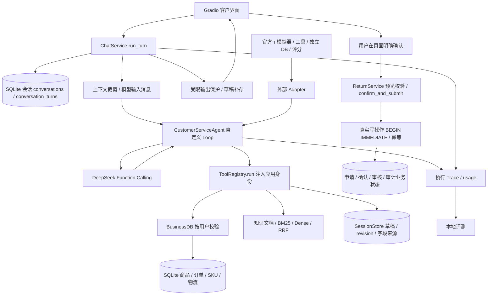
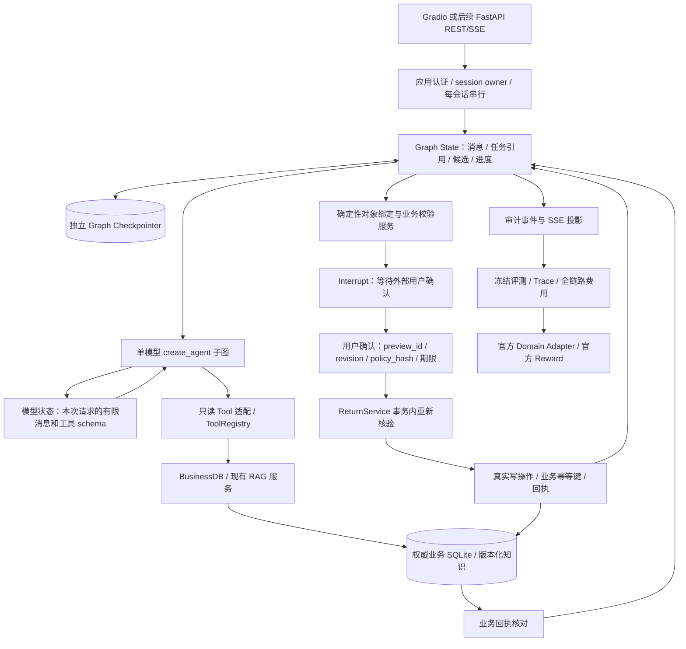

# V3 架构规格与本轮实现边界

核验日期：2026-10-23。运行基线为远端 main `f34981f`，实验分支为
`feat/v3-langgraph-poc`。本轮只实现只读模型与工具循环、消息持久化、恢复和审计事件。
任务账本、事实账本、Interrupt 确认、FastAPI 和完整售后图均为下述迁移设计，尚未实现。
验收证据见 [REPORT](../../results/v3_langgraph_poc_20261023/REPORT.md)。

## 1. 基线选择

| 审查对象 | 固定提交 | 实际状态及复用决定 |
| --- | --- | --- |
| 本地 main | `3a4de7c` | 已落后，不用它代表远端 main |
| 远端 main | `f34981f` | 已合并 V1 与独立 seed clock 修复；作为可回退运行基线 |
| 原工作分支 fix/tau-formal-recovery | `f780f17` | V2 加正式评测恢复与费用修正；保留证据，未作为 PoC 运行依赖 |
| [PR #4](https://github.com/qingtian-4/ecommerce-agent/pull/4) | `f6c3387` | OPEN、draft、base main；V2 Router、Recovery、Progress，不等于 V2.1 |
| fix/runtime-v21-evidence | `c513061` | 增加写回执核验与路由补足；参考其回执契约，不整体合入 |
| fix/v21-mixed-answer-evidence | `c12bb62` | 混合咨询与写回执共存；仍是有限保护 |
| integrate/runtime-v21-delivery | `29c603f` | 已整合上述修复和审计资料；没有授权合入 main |
| fix/order-action-completeness | `a862a20` | 支持有限混合表达的订单草稿补存；不将该表达规则迁移成 V3 核心 |
| fix/seed-business-clock | `add50f2` | 已被 main 包含，可直接复用 |

没有 cherry-pick 未合并 Runtime。后续评测若比较 V2.1，必须固定其独立 SHA，不能把它叫作
main/V1。本轮原工作树的 TODO、技能锁和附加文件不进入实验提交。

## 2. 当前端到端路径

图中外部 Adapter 在独立分支 `scripts/tau_acs_agent.py`；main 的历史适配入口是
`scripts/eval_tau_retail.py`。外部路径绕过 ChatService、SessionStore、本店 SQL、RAG 与 UI，
所以官方工具循环成绩不能证明本店完整退货链路。

main 的 SessionStore schema 为 v5；PR #4 及 V2.1 分支为 v6，增加反馈表。
模型输入在 `agent.messages`；会话消息在 `conversation_turns.messages_json`；答案与 Trace
在 answer/result_json。草稿在 return_tasks，材料、预览、确认、申请、审核另表存储，
与会话表同属业务 SQLite，但生命周期和权威性不同。重启恢复会话不等于恢复 Loop 的执行栈。

## 3. V3 目标结构，除只读子图外尚未接线

最脆弱的假设是“持久消息足以维持任务和对象”。本轮小样本只验证了若干指代与插问，
没有证明复杂混合请求泛化。目标结构保留显式任务与对象状态的扩展位置，不因框架持久化
就认定问题已解决。单模型继续选择工具；确定性服务核验事实与授权，不增加独立 LLM Agent。

### 四种状态的权威边界

| 状态 | 拟定契约 | 谁可更改 |
| --- | --- | --- |
| 模型上下文 | 从 Graph 投影的当前消息、必要任务事实、工具定义 | 应用构建输入；模型输出只是提案 |
| Graph State | native AgentState.messages；后续增加 tasks、entity_bindings、fact_refs、pending_confirmation、business_receipt_refs、schema_version | 节点通过 reducer 更新，Checkpoint 保存；不保存 SQLite 连接 |
| 业务状态 | 订单、明细、SKU、草稿 revision、预览、材料、确认、申请与审核 | BusinessDB/SessionStore/ReturnService 强制身份与事务；模型不得直连 |
| 长期用户记忆 | 后续若有明确需求才用 Store 保存带来源偏好 | 独立用户命名空间和授权；本轮没有 Store 实例 |

后续 TaskProposal 拟用 Pydantic 限定 task_id、kind、user_source_turn、source_quote、
entity_refs、status、missing_fields；模型提案经过来源与候选校验后进入 Graph。FactRef
拟包含 subject_id、field、value、source_type、source_id、observed_at、version。
用户自述、查询事实、历史回执各自保留来源，不自动把自述升级为已核验事实。
这些类型本轮只形成契约设计，没有新增空实现或虚构已运行的 Task/Fact Ledger。

## 4. 一致性与故障协议

Graph Checkpoint 与业务 SQLite 是两次独立提交。`durability="sync"`只约束 Graph 的持久化顺序，
不能覆盖业务事务和外部副作用。以下是完整写链路迁移的验收要求，PoC 通过完全不暴露写工具
绕开写入窗口，没有宣称已解决跨库原子性。

| 故障或交互 | 迁移规则 | 本轮状态 |
| --- | --- | --- |
| 写已提交，Graph 保存失败 | 稳定业务幂等键先落权威库；恢复先查回执，禁止凭旧 Graph 再写 | 现有 preview_id 幂等保留；Graph 写桥未实现 |
| 写请求超时，不知是否生效 | 标记 outcome_unknown，核对业务状态；查不清则停止，不盲重试 | 参考 V2.1/haike 实现；本轮无写请求 |
| 工具确定性失败 | ToolMessage.status=error，Trace 同步 error；允许模型纠正参数或说明失败 | 已实现并有 DB 故障测试 |
| 模型错误、崩溃 | 恢复相同 thread 的未完成节点；成功节点不靠自写 generator 重建 | 已实现，真实连接失败与 os._exit 测试 |
| 流中断或客户端断开 | token/node_update 为暂态；仅持久化终态后发 run_completed；断开不能解释为业务取消 | CLI 关闭流有审计；未实现 HTTP 断连/重连 |
| 模型回复被截断 | 在消息进入下一节点前拒绝 incomplete，保留可恢复的模型节点 | 已实现，不能把 length 标为完成 |
| 未开放的工具意图 | 工具执行前停止本轮，不让模型在拒绝后继续生成办理声明 | 已实现；不保证识别任意自由文本幻觉 |
| 旧确认恢复 | 确认绑定主体、preview、revision、政策版本和期限；事务内重新读取；对象更正使旧确认失效 | ReturnService 已有校验；Interrupt 桥未实现 |
| 插问与对象更正 | tasks 按 task_id/entity_id 保存；插问只改变当前焦点，明确更正使关联选择/确认失效 | 本轮只验证消息历史和少量真实表达 |
| 多候选或同名 | 保留候选集合和歧义状态，用户明确选择后才绑定 | 本轮真实多候选订单验证，未做通用消歧引擎 |

Interrupt 节点恢复会从节点开头重新执行。因此提案生成、等待确认与真实写入应分开，
确认前不做非幂等副作用。恢复输入由应用校验所属用户和确认 token；普通聊天“确认”不等于
页面确认。确认后进入 ReturnService 的事务复核，不能相信 Checkpoint 中 cached eligibility。
参考 [Interrupt 原生语义](https://docs.langchain.com/oss/python/langgraph/interrupts)。

## 5. 已实现 PoC

入口：[langgraph_poc.py](../../src/acs/langgraph_poc.py)、
[CLI](../../scripts/langgraph_poc.py)、[费用闸门](../../src/acs/poc_budget.py)。
原生 create_agent 管理 model/tools 循环，SqliteSaver 保存消息和 middleware 状态；没有手写 StateGraph。
Pydantic 校验六个只读工具参数和 AuditEvent。每个成功工具调用继续通过 ToolRegistry.run，
身份由应用闭包注入；BusinessDB 做订单归属校验。未绑定退货任务、未暴露业务写工具。

checkpoint 数据库包含 native checkpoints/writes 与 poc_threads。poc_threads 绑定 session、user、
runtime_version、business_path；加载历史前校验。CLI 为每个 checkpoint 文件持有进程锁，
竞争 worker 直接拒绝。该保守实现只支持本机单 worker，不是网络认证或多副本服务。
审计 JSONL 含 event_id/run_id/session_id/sequence/UTC timestamp，记录真实工具调用及结果。
`run_completed`携带已落盘 checkpoint_id；事件日志没有与 Checkpoint 共事务，崩溃时允许
缺少末尾投影事件，恢复以 native snapshot 为准。没有实现 exactly-once SSE 交付。

## 6. 对外接口与兼容性，服务接口为后续设计

后续 FastAPI 接口拟为 POST /sessions、POST /sessions/{sid}/turns、
GET /sessions/{sid}/events、GET /sessions/{sid}、POST /sessions/{sid}/confirmations。
服务端生成 run_id/input_id，并校验 authenticated principal、session owner 和输入幂等键。
SSE 的 id 对应稳定业务事件游标；Last-Event-ID 从持久事件投影恢复，不能重跑 Graph 作为补帧。
该服务和重连协议本轮均未实现。

现有 Gradio on_send 消费 TurnUpdate/AgentResult，自定义 Loop 消费字典 Function Calling 消息；
PoC 返回 AuditEvent 和 native BaseMessage。不能直接替换其类型。下一阶段需要受测的边界转换，
保留 tool_call_id、ToolMessage.status、可选 usage 和停止原因；不双写两套会话消息作为权威。
旧 SessionStore 的历史导入只允许完整工具配对、已结束且归属明确的轮次，必须显式迁移。
本轮没有导入旧会话，不重写现有数据库迁移号或检索索引。

## 7. Go / No-Go

Go：继续隔离只读 Graph 和 Adapter 合同验证。No-Go：默认替换 Loop、完整售后写入、生产开关、
换货与大规模收费评测。LangGraph 减少了本轮手写执行栈和消息恢复代码，业务授权、对象语义、
内容真实性、跨库一致性及评测公平性仍须项目实现和独立验收。
