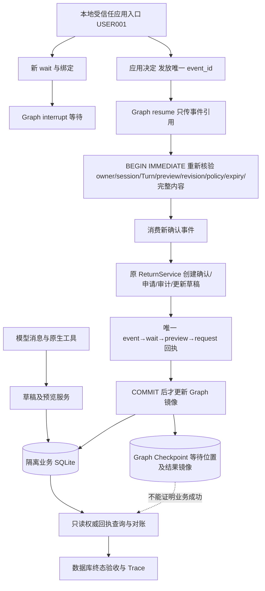

# M6：隔离原子模拟申请提交

本轮从 `47ec9c5` 创建 `feat/v3-atomic-return-submission`，复用原 V3 Worktree。仅新增合成 SQLite 中的 `pending_review` 模拟申请，不代表真实平台已受理，不涉及审核、退款、支付或物流执行。本轮模型 HTTP 请求与费用均为 **0**。

## 实现与事务审计

| 职责 | 源码 | 本轮处理 |
|---|---|---|
| 原有提交业务规则 | `src/acs/returns.py` | 将原 `confirm_and_submit` 事务体等价抽取为 `_confirm_and_submit(conn,...)`；公开 API 仍自己持有事务，默认审计 entry 保持不变 |
| 原生 Interrupt 与应用事件 | `src/acs/local_confirmation.py` | 保留等待、事件发放、校验、消费生命周期；新增最小 `_consume` 扩展点，原草稿确认行为不变 |
| 隔离提交桥 | `src/acs/local_submission.py` | `FormalConfirmation` 在消费事务中调用原业务方法并写唯一回执；`FormalReturnPoc.submission` 是应用 API，不是 Tool |
| Fixture 与权限屏障 | `src/acs/local_return_tools.py` | 新建 `local-return-formal-synthetic-1`；原 `local-return-draft-only-1` 的 12 个禁止正式写入 Trigger 全部保留 |
| 只读恢复 | `read_submission_receipt()` | 验证 Fixture 后通过 `mode=ro` 一致性读事务查询；不迁移、不打开 Graph、不重放写入 |
| 模型宿主 | `src/acs/local_return_poc.py` | 默认类仍只接收草稿 Fixture；实验子类有独立 Fixture 类型与提示词，12 个模型工具保持不变 |

旧 ReturnService 校验仍包含：会话所有权、正在执行的 Turn、预览绑定、草稿状态与 revision、有效期、政策 hash、交付状态及退货期限、数量余量、质量凭证、用户声明、原业务字段一致性。新桥额外沿用既有确认门的**最新预览和完整内容相等**检查，没有另写退货规则。



事件发放是前置事务；**确认消费、return_confirmations、return_requests、return_audit、return_tasks 和 local_submission_receipts 必须在同一个业务连接、同一个 BEGIN IMMEDIATE 中提交**。内部 ReturnService 方法不 commit、不再开连接。原数量 Trigger、预览唯一约束继续生效；回执对 event/wait/preview/request 分别唯一。

正式 Fixture 只允许连接临时注册、且与已接受事件绑定的 SQL capability 执行三张业务表 INSERT。申请必须为 `pending_review`、审计必须为 `created`。UPDATE/DELETE、审核和订单/明细/物流变更均禁止。许可在 `finally` 撤销。模型既拿不到连接，也拿不到提交方法。旧 Fixture 不能通过修改 marker 切换为正式 Fixture；没有删除任何旧 Trigger 的升级路径。

## 确认与恢复合同

- 当前 CLI 由本地操作者固定使用合成身份 USER001。应用方法重新检查用户、会话和有效业务状态；聊天“确认”、Tool Call、伪造 Graph Resume 都不能发放事件。
- 确认绑定用户、会话、预览 ID、revision、policy hash、expires_at；消费时重新生成并比较完整业务内容。M5 已消费的 accepted 回执不能用来提交，必须新建等待和新事件。
- 重复成功点击返回原申请；不能把成功申请通过取消按钮改回草稿。新事件不能再次提交已用预览。
- 提交结果未知时先查询 SQL：有完整成功回执则只返回原申请；确认、申请、审计或回执不一致则停止，不能自动重放。
- 显式 resume 仅在一致性查询证明没有已提交申请后继续未完成事件，并在事务中重验全部绑定。COMMIT 前进程退出由 SQLite 回滚；COMMIT 后丢回执通过只读查询找回。
- Graph 线程丢失、结果或 wait_id 损坏会标为 `reconciliation_required`。整个 Graph 文件丢失/损坏仍可用独立 CLI lookup 获取权威成功回执；本轮不自动修复镜像，也不为修镜像重复提交。
- 最新预览现在统一使用 `created_at DESC,rowid DESC`，同时间戳按插入次序稳定选择。两处查询均有回归覆盖。

## 运行与证据

依赖沿用 `uv.lock`：Python 3.13，Linux/WSL，单 Worker。初始化只接受不存在的目录，不能连接任意旧业务库。

```bash
uv sync --extra dev --extra v3 --extra tau --frozen
uv run python scripts/eval_atomic_submission.py --out /tmp/m6-fresh-evidence
# 输出 scorecard.json；每个动作是新 CLI 进程，私有目录含初始/最终合成 SQLite 和完整 stdout/stderr。

uv run python scripts/local_formal_submission.py --state-dir /tmp/m6-manual init
uv run python scripts/local_formal_submission.py --state-dir /tmp/m6-manual new
# 用上一步 session_id 替换 SID；stage 8 可直接准备完整草稿及预览。
uv run python scripts/local_formal_submission.py --state-dir /tmp/m6-manual stage SID 8
uv run python scripts/local_formal_submission.py --state-dir /tmp/m6-manual open SID
# 用 open 返回的 wait_id 替换 WAIT。
uv run python scripts/local_formal_submission.py --state-dir /tmp/m6-manual decide SID WAIT accept
uv run python scripts/local_formal_submission.py --state-dir /tmp/m6-manual lookup SID WAIT
uv run python scripts/local_formal_submission.py --state-dir /tmp/m6-manual inspect SID
```

`tests/test_atomic_submission.py` 是本轮新增专项；`test_return_submission.py`、`test_local_confirmation.py`、`test_local_return_poc.py` 覆盖旧业务、草稿及确认回归。完整验证命令：

```bash
TAU2_DATA_DIR=/tmp/acs-external-tau-20261022/data LITELLM_LOCAL_MODEL_COST_MAP=True \
  GRADIO_ANALYTICS_ENABLED=False ACS_LLM_API_KEY='' ACS_EMBEDDING_API_KEY='' \
  uv run pytest -o addopts='' -q --junitxml=.ci-artifacts/pytest.xml
uv run ruff check .
uv run python scripts/check_secrets.py --all-tracked
```

固定模型仅验证执行协议，不代表新增真实模型成绩。冻结八阶段输入与旧脚本逐字比较，包含插问、更正、取消、恢复和最新预览。公开 Scorecard 保存合成 SQL 前后状态及源码指纹；完整运行 Trace 和 SQLite 保存在被忽略的 `.private-evidence/`，不覆盖 M4/M5 真实运行。

最终执行结果与故障矩阵见 `results/atomic_submission_20261024_run3/REPORT.md`；首次 CLI 参数错误保留在 run1，迭代诊断成功保留在 run2。最终提交 CI 以该 SHA 的 GitHub Offline checks 为准，最终回复提供运行链接和数量。

## 结论及边界

源码提交 `93c3b30` 的完整CI已通过（945 passed、0 skipped，JUnit已下载核验），39项新增事务/恢复用例全部成功。**Go：下一轮接入隔离 FastAPI/SSE 与业务确认 UI**。生产使用仍 **No-Go**：当前只有固定合成身份的本地 CLI，没有生产身份认证、CSRF/重放入口治理、平台回执协议、多 Worker 协调、备份/审计保留和监控验收。文件系统所有者仍能篡改 SQLite，连接 capability 不是对抗主机管理员的安全边界。真实平台提交、审核、退款、默认 Runtime 切换均未实施。

验收CI：[40054427592](https://github.com/qingtian-4/ecommerce-agent/actions/runs/40054427592)。证据汇总与逐项故障结果：`results/atomic_submission_20261024_run3/ci_acceptance.json`。实跑44个源码/依赖文件指纹与93c3b30一致；最终交付还包含CI证据文档提交，其CI在最终回复给出。
