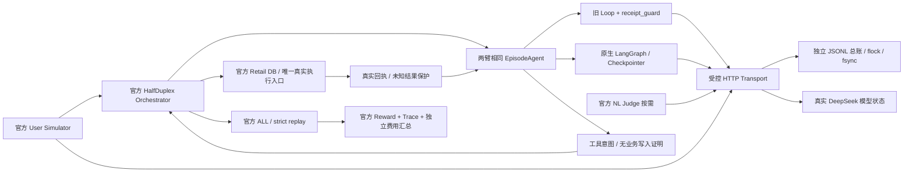

# 统一 Episode 预算与 DeepSeek Development Pilot

本轮基于 `d7da103`，实验分支 `feat/v3-episode-deepseek-pilot`。默认 Agent、main、PR #4、本地业务库和历史结果均不变。

**本轮结论：No-Go。** 统一预算与费用账本通过 810 项回归（0 跳过），但真实任务 33 的旧 Loop 为官方 Reward 1、V3 因模型协议守卫停止为 0；任务 34 两臂未启动，无重跑。17 次实际付费请求，按 usage 和已核实非峰时价估算 0.0123984 CNY，保守预留 1.372904 CNY。旧版与 V3 的响应接受条件仍不一致，且被拒绝的供应商原始输出未留存，不能完成真实效果对照。

## 实现与权限边界

| 位置 | 实际职责 |
| --- | --- |
| `src/acs/runtime.py:BudgetJournal` | 复用 PoC 的追加、flush、fsync 记账方式，POSIX flock 覆盖检查与追加 |
| `src/acs/episode_budget.py:EpisodeLedger` | 同一实验、所有角色及 Episode 的预算、预留、回执、终止原因和费用汇总 |
| `src/acs/episode_transport.py` | 实际 HTTP 前预留；覆盖 OpenAI SDK、ChatOpenAI Callback、官方 LiteLLM 的 SDK 路径 |
| `scripts/tau_episode.py` | 同一外层 HalfDuplex 边界包装两组 Agent；工具意图、回执、恢复保护和官方 usage/cost 导出 |
| `scripts/eval_tau_development_pilot.py` | 冻结、离线门禁、价格核实、单次串行运行、官方评价和原始结果保存 |
| `tests/test_episode_budget.py` | 强制安装依赖的 SDK、官方 Retail、预算与恢复合同测试，无 skip 降级 |

`PocBudget` 与 Episode 账本复用 `BudgetJournal`，但不把旧 PoC 的 40 次、USD 汇率和中文业务限制带入官方协议。`RunBudget` 及旧默认行为保留；旧 LLMClient 仅新增可选异步 SDK 工厂，默认不启用。`deepseek_model` 仅增加可选 HTTP 客户端注入。旧 ACSAdapter 显式传入 Settings 时保留该设置；默认仍沿用 64000 字符上下文。

工具只有官方 Orchestrator 的 Environment 执行。Graph 的占位工具不能执行本地业务。Host 在原始 `step` 和 `get_response` 外记录调用，不改官方方法实现、Task、Policy、DB 初态、模拟用户或评价器。评价器在独立环境重放，不会误计为真实工具执行。



这张图没有本地退货确认节点。官方任务中的授权仍由原始政策和用户模拟完成；本轮没有实现本地 UI 确认迁移。

## 冻结预算与计费

两个 Runtime 每 Episode 都是 24 次实际 HTTP 尝试（Agent、User、Judge 合计）、24 个工具意图、80 个官方步数、单请求 60 秒和总 Episode 300 秒。整个实验最多 48 次付费 HTTP、5 CNY 保守不可退款预留。请求失败也占次数和预留；SDK 与 LiteLLM 重试为零。内部模型和工具限制为 49，旧回合期限和 Graph 期限均比外层更长，不能提前截断正常对照任务。

请求前按实际序列化 HTTP UTF-8 字节数的两倍加 4096 预留输入 Token，输出封顶 1024；缓存全部按峰时 miss 预留。当前核实的 Flash 人民币峰时价为每百万输入 miss 2 元、hit 0.04 元、输出 8 元；非峰时减半。来源为[官方人民币定价](https://api-docs.deepseek.com/zh-cn/quick_start/pricing/)。同时核实[官方美元定价](https://api-docs.deepseek.com/quick_start/pricing/)以导出 τ 原有 USD `cost` 字段，不用美元汇率控制人民币上限。

价格页面摘要与内容指纹在运行前保存并再次比对。只接受直接 DeepSeek endpoint、`deepseek-flash`、单输出、non-thinking 和显式输出上限。运行前通过[官方余额查询](https://api-docs.deepseek.com/api/get-user-balance/)确认人民币账户可用；不保存凭据或账户余额。

账本包含每次请求的模型、角色、时间、请求体指纹、预留、实际输入输出及缓存 Token、延迟、HTTP/异常状态。缺少 usage、超出预留、失败或未收到回执都不能按免费处理。未结算部分保留全额预留，报告未知费用数量。费用分别列 Agent、User、Judge，再汇总 Episode 和全场；峰时估算、按时段估算、预留和供应商真实账单分别说明，不能混为一项。

## 新旧协议与可比性审计

| 项目 | 旧 Loop 对照 | LangGraph | 结论 |
| --- | --- | --- | --- |
| 政策与工具 Schema | 官方原始数据 | 同一官方原始数据 | SDK 级离线对照 |
| 模型采样 | Flash / 温度 0 / non-thinking / 输出 1024 | 相同 | 冻结采样参数 |
| 工具执行 | 官方 Environment | 同一 Environment | 不执行 Graph ToolNode |
| receipt_guard | **本次对照明确启用**，默认不变 | 原生 Adapter 启用 | 未知写结果均持久化停止 |
| 消息格式 | Python 字典 | LangChain 原生消息与 Checkpointer | 消息语义与工具 ID 对照 |
| HTTP | SSE streaming | native ainvoke 非流式 | 传输差异，不宣称逐字节相同 |
| 输出 Token 字段 | `max_tokens` | SDK 序列化为 `max_completion_tokens` | 同一上限，账本接受互斥别名 |
| 历史工具参数字符串 | 保留供应商原始 JSON 格式 | LangChain 由参数对象重新序列化 | 可能有空格差异；比较 JSON 语义，不改写消息 |
| 工具结果 | 官方原始回执，模型投影沿旧序列化 | 同一协议投影 | 账本不更改 content |
| Agent usage/cost | 每请求 delta 覆盖旧累计导出 | 从同一 HTTP 账本导出 | 按稳定输出指纹持久化，可恢复同一 outbox 输出 |
| User/Judge 费用 | 官方 LiteLLM 未识别价格时可能返回 0 | 同一路径 | 权威费用来自受控 HTTP 账本；导出 User cost 元数据，保留 Reward |
| 停止原因 | 外层规范原因 | 同一外层规范原因 | 模型超时与 Episode 到期分开 |

账本不改变 Model/Tool 消息正文。预算触发后外层返回明确停止消息，不把未完成调用伪装成正常回答。官方提前结束返回的 Reward 仍原样保留；没有经过官方评价的异常运行用 `reward=null`，不编造零分。任务 33/34 的评价依据仅 DB，本轮不验证 Judge 准确性，也不报告 pass^k。

## 恢复、审查发现与限制

- Episode 起始时间、期限、计数和不可退款预留均在 journal；相同 Episode 重开不会重置，修改限制会拒绝。
- 每个工具 ID 先记 intent；真实回执即使迟于期限也先保存，再禁止新请求。重复 ID、错 ID 或错 requestor 停止。
- `receipt_guard` 的未知写结果、协议失败和模型失败必须持久化停止；新实例也不能绕过。Graph Checkpoint 不是官方 DB 写成功的证明。
- 原生 Graph 的最终输出 outbox 可恢复；usage/cost 与稳定输出指纹绑定，避免交付前退出后漏记。旧 Loop 的 Python 生成器不能序列化。本轮只支持用完整已核实历史重新接续并继承预算，未核实工具操作需要外部对账。
- 不支持官方 Orchestrator、Retail DB 与 Graph 的原子恢复。`partial.json` 是诊断记录，不能作为完整恢复镜像。真实入口的 `RUN_STARTED` 禁止整场自动重跑；异常保存后停止，不换模型、不改题、不改评分器。
- SQLite Checkpointer 仍为单 worker、独立文件；同步边界使用固定 `asyncio.Runner`，每次异步 SDK 请求在其所属循环内关闭。POSIX flock 为 Linux/WSL 验收，不宣称 Windows 原生兼容。
- `tau_tool_protocol.py` 未新增异常文案补丁。其业务拒绝分类来自固定上游源码中声明的 ValueError 模式，仍依赖该版本源码；升级上游必须重新审查。未知 mutating 结果按不确定写保护，不能据错误字符串推定写成功。

审查已修复的具体窗口：未知写 guard 未进入外层终止账本；期限检查导致迟到回执丢失；最终回复交付前标记已导出导致恢复后少记 Token；官方提前结束的 `reward_breakdown=None` 被展示代码误判为仿真异常。对应测试在 `test_episode_budget.py`，真实执行结果见实验目录。

## 实验结果与运行方法

最终数字、原始 Trace、官方 Reward、失败记录、请求数量和费用统一见 [实验报告](../../results/tau_development_pilot_20261023/REPORT.md)。本文说明实现和限制，实验报告记录本次实际执行结果。

```bash
uv sync --extra dev --extra v3 --extra tau --frozen
export TAU2_DATA_DIR=/path/to/tau2-dd8757d/data
export LITELLM_LOCAL_MODEL_COST_MAP=True
uv run pytest --junitxml=.ci-artifacts/pytest.xml
uv run ruff check .
uv run python scripts/check_secrets.py --all-tracked
uv run python scripts/eval_tau_development_pilot.py --help
# 下面的新目录不得与本次原始结果重名。
uv run python scripts/eval_tau_development_pilot.py \
  --upstream /path/to/tau2-dd8757d --out results/new_explicitly_authorized_pilot --freeze
# 必须保存同一源码的 gates.json、JUnit 和人工核实的 price_review.json；
# --run 会校验，缺少或不同版本即拒绝。不会隐式读取旧绿灯。
# 实际付费运行还须有对应用户授权：
uv run python scripts/eval_tau_development_pilot.py \
  --upstream /path/to/tau2-dd8757d --out results/new_explicitly_authorized_pilot \
  --run --env-file /absolute/path/to/.env
```

本次检验日志留在结果目录的 `intermediate/`（Git 忽略）；CI 的 JUnit 通过 `offline-check-evidence` Artifact 保留 14 天。已有 15 MB 历史 Adapter 输出保留，不追溯删除。新提交只版本控制冻结清单、必要检查摘要、最终账本、Scorecard、失败样例及压缩原始 Trace。

后续独立留出实验应先按原始 Task reward_basis、工具链长度、澄清和业务写类型分层冻结未参与开发的 ID，再冻结两臂条件与预算，每臂每题一次仅报告逐题官方 Reward。至少独立重复 k 次后才考虑 pass^k；开发期 33/34 不进入留出组。本轮不启动该实验。当前必须先解决共同模型响应守卫和拒绝输出取证两个阻塞，再另行授权并冻结真实实验。

留出组还须先汇总历史实验清单和人工浏览记录。若官方原始 base 任务已全部曝光，不能把重新抽取的子集称为未见集；应标成历史任务冻结复验，另行设计合规的新域任务与人工 Gold，不改本轮官方任务或评价器。

新实验目录的离线门禁可用以下命令重建；它不会调用付费模型。必须先通过 `--freeze` 建立新的实验目录，替换 `out`，并人工核实 `price_review.json` 中的数字与页面指纹。`gates.json` 指向忽略目录内本次生成的 JUnit；不能复制其他源码版本的绿灯。

```python
# 在仓库根目录用 uv run python 执行
import json, subprocess, sys
from pathlib import Path
sys.path.insert(0, "scripts")
from eval_tau_development_pilot import fingerprints
out = Path("results/new_explicitly_authorized_pilot")
checks = out / "intermediate/checks"
checks.mkdir(parents=True, exist_ok=True)
gates = {"source": fingerprints()}
commands = {
    "pytest": [sys.executable, "-m", "pytest", "--junitxml=" + str(checks / "pytest.xml")],
    "ruff": [sys.executable, "-m", "ruff", "check", "."],
    "secrets": [sys.executable, "scripts/check_secrets.py", "--all-tracked"],
}
for name, command in commands.items():
    with (checks / (name + ".log")).open("w") as log:
        result = subprocess.run(command, stdout=log, stderr=subprocess.STDOUT)
    gates[name] = {"exit_code": result.returncode}
gates["pytest"]["junit"] = "intermediate/checks/pytest.xml"
(out / "gates.json").write_text(json.dumps(gates, indent=2))
```
