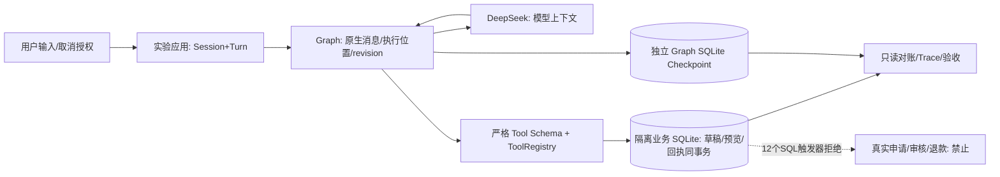

# 本地退货草稿集成审计

基线 `35e746a`；独立分支 `feat/v3-local-return-draft`；复用 `/tmp/ecommerce-v3-episode-pilot-20261023`。默认入口、主目录用户修改、历史结果保持原样，未整体 merge 历史分支。

| 对照 | 已核查差异 | 本轮选择 |
|---|---|---|
| main / f34981f | 当前 V3 包含 main 的 P0/P1、日期 fixture 修复；本地核心文件与 main 相同 | 保留业务实现 |
| integrate/runtime-v21-delivery / 29c603f | 未整体包含 V2/V2.1 Router、Recovery、Progress、write_evidence、consultation | 不复制 Runtime；使用 native create_agent + SQL 业务回执 |
| fix/order-action-completeness / a862a20 | 未包含；混合咨询曾使用“同时说明/介绍”等专用分支 | 不复制词组补丁；原生工具历史与最终答复分别保留 |
| fix/v3-response-contract-parity / 35e746a | 已含原生 Graph、共享 Model Response Contract、持久费用账本和响应取证 | 复用，不扩展官方 Adapter |

历史证据：`29c603f:docs/TAU_V21_STAGE_ACCEPTANCE_20261022.md`、`29c603f:docs/RELIABILITY_GAP_PRIORITIES.md`、`a862a20:tests/test_action_completeness.py`。D01/D02 的事实是读取订单后没有保存草稿，不能直接推断成记忆丢失；D05 混合动作遗漏、整句取消授权受限及输出覆盖咨询是不同问题；D06 否定取消不应执行，但不能掩盖此前草稿缺失。

| 旧职责 | 实验接入 | 权威 |
|---|---|---|
| ChatService / Loop | `LocalReturnPoc` 应用宿主；create_agent 内置 model/tools 节点 | Graph 只保存消息及执行位置 |
| SessionStore | 原实现；仅抽取原有 BEGIN IMMEDIATE 为可组合 transaction | 身份、当前运行 Turn、草稿 revision、来源与依赖清除 |
| ReturnService | 原 preview/latest_preview；preview 改用相同事务入口 | 政策、期限、数量、预览有效性 |
| ToolRegistry | 每次执行重新绑定应用 context，严格 Schema 拒绝额外身份参数 | 权限与业务工具执行 |
| Recovery | 显式 resume + 回执/参数/结果核对 | 业务 SQLite 成功回执，不能从 Checkpoint 推断提交 |
| RAG | 既有 chunker + BM25 LexicalIndex；隔离 docs 快照 | 实际政策文件及 hash |

## 状态和授权

应用传入 user_id，SessionStore 校验 session 所有者。`local_threads` 保存 Session→随机 Graph Thread、当前 Turn、该轮消息 offset；Graph State 仅包含原生消息、turn_id、模型决定时 revision。每次工具调用（含只读和重放）重新核验当前数据库中的 owner、running Turn 和映射；Checkpoint 中没有可直接使用的权限。

取消边界：沿用 SessionStore 整句明确授权。否定、引用、假设、模糊取消均拒绝；“取消草稿，同时问运费”仍要求用户单独明确取消，咨询继续正常回答。没有新增关键词正则，也没有采用旧 ChatService 替换整个答案的输出保护。模型是否完整回答仍需真实验收，固定模型合同不能证明质量提升。

工具清单由 `local_return_tools.TOOLS` 唯一允许；没有 confirm_and_submit、审核、原始连接或身份切换。隔离 fixture 独立复制种子业务数据与政策，写入四个正式表的 INSERT/UPDATE/DELETE 均由触发器拒绝。CLI 的 user-id 是可信本地操作者注入，不是网络认证机制。

## 生命周期和边界

Linux/WSL 专用 fcntl 文件锁，每 fixture 单 worker；同一实例 run_lock 拒绝并行 Turn，SQLite BEGIN IMMEDIATE 串行化写入。不同 session 独立 Thread、owner、revision；不承诺多 worker 或 Windows 原生。native 批次工具以 max_concurrency=1 串行执行。采用 updates streaming，只有完成节点输出与持久 Trace 是可见证据；不宣称有即时 SSE 或 custom 进度流。

业务操作及回执同事务，SAVEPOINT 回滚业务拒绝；Graph 与业务 DB 没有跨库原子事务。恢复必须核对 Thread/Turn、offset、call ID、工具名、规范参数及原始结果。合法提交后丢回执通过相同 call ID 读回，不重新变更；revision、过期、政策改变后旧预览不自动重生。镜像缺失、错配或未知回执停机待人工恢复。必须成套备份业务/Graph/fixture/docs，而不是任意恢复一份 DB。

每轮模型调用前补充当前业务事实；历史原生消息保留且随轮数增长，本轮没有实现压缩或无限会话预算保证。费用账本与业务回执职责独立；32 请求/3元上限跨 CLI 进程保留，失败和 usage 缺失不免费。
