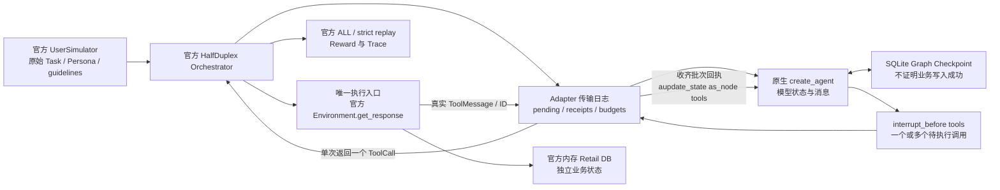

# LangGraph × τ²-bench HalfDuplex Adapter 离线验收

本轮实现官方文本 HalfDuplex Adapter，默认客服 Agent 未替换。固定模型决定用于验证协议，不能据此报告真实模型任务成功率、pass^1 或 pass^k。付费请求为零。

基线是 `576f56fd3cd13d04244a19fd00c8419f34808bed`；独立分支为 `feat/v3-tau-langgraph-adapter`。开始时远端基线与本地一致，基线 CI `39927740689` 成功。原工作区的三个已有修改及历史结果按 [freeze.json](../../results/tau_langgraph_adapter_20261023/freeze.json) 保留。

## 固定版本与运行入口

上游固定 `sierra-research/tau2-bench@dd8757d4c8791dad7b3cdaf02a105a3d5f9d86bd`，包版本 `1.0.1`。不使用其他 commit，也不把这次结果与 2.0 或历史真实 DeepSeek 分数合并。版本名称不足以识别协议；完整 SHA、源码与数据哈希才是本轮证据。

代码与依赖：

- [tau_langgraph_agent.py](../../scripts/tau_langgraph_agent.py)：`LangGraphAgent`、持久化 `LangGraphState(thread_id)`、官方 Factory `create_langgraph_agent`。
- [tau_tool_protocol.py](../../scripts/tau_tool_protocol.py)：两侧共用的回执合同校验，不执行工具。
- [tau_acs_agent.py](../../scripts/tau_acs_agent.py)：旧 Loop 保留；新增离线模型注入和可选 `receipt_guard`。默认 `create_acs_agent` 不启用此保护，原本的默认停止行为保留。
- [check_tau_langgraph_adapter.py](../../scripts/check_tau_langgraph_adapter.py)：无付费模型客户端的完整离线入口，先验证干净上游、安装来源及所有官方 Python 源码，再运行强制合同与导出对照证据。
- [test_tau_langgraph_adapter.py](../../tests/test_tau_langgraph_adapter.py)：缺少 τ、LangGraph 或原版数据时直接失败，不以 skip 代替验收。

Python 仍为 3.13.12。原有 96 个锁定包均未升级或删除；可选 `tau` extra 使锁文件新增 28 个包条目。上游要求 Python `>=3.12,<3.14`，因此 extra 有对应 marker，主项目 `>=3.11` 不变。运行本轮测试须使用 Python 3.12 或 3.13。详见 [dependencies.json](../../results/tau_langgraph_adapter_20261023/dependencies.json)。

```bash
# 在本分支工作目录执行；上游须是干净的原始 checkout。
git clone https://github.com/sierra-research/tau2-bench /tmp/tau2-dd8757d
git -C /tmp/tau2-dd8757d checkout dd8757d4c8791dad7b3cdaf02a105a3d5f9d86bd
uv sync --extra dev --extra v3 --extra tau --frozen
uv run --no-sync python scripts/check_tau_langgraph_adapter.py \
  --upstream /tmp/tau2-dd8757d --out /tmp/tau-langgraph-offline

# 完整回归；无需 API key。
TAU2_DATA_DIR=/tmp/tau2-dd8757d/data LITELLM_LOCAL_MODEL_COST_MAP=True uv run --no-sync pytest
uv run --no-sync ruff check .
uv run --no-sync python scripts/check_secrets.py --all-tracked
```

输出目录必须是新目录，避免覆盖证据。CLI 的 `manifest.json` 冻结源码、Retail 数据和依赖；`paired/*.json` 保存双方全部模型请求、官方工具调用、原始回执、终态哈希与官方 Reward；脚本模型的 usage／cost 是固定桩值，不属于真实消费。`junit.xml`、`pytest.log` 和 `summary.json` 提供逐项验收记录。

## 暂停、执行与恢复



模型绑定完整官方 System Policy 和原始 Tool Schema。`StructuredTool` 只有会抛异常的占位函数；Graph 在 `tools` 前原生暂停，Adapter 从 checkpoint 读取调用，按模型顺序逐个交给官方执行器。批量调用可能在原生 Graph 产生多个 `tools` 任务，因此检查全部待执行节点，不能只判断 `next == ("tools",)`。

每次派发前，先将 `pending` ID 与工具计数提交到传输日志。回执必须对应当前 pending，且 requestor 为 assistant；重复、错 ID 和插入新用户消息会被拒绝。收齐整个模型批次后，以稳定消息 ID `receipt:<call_id>` 注入原生 `ToolMessage`，通过 `as_node="tools"` 将节点输出记录为已完成，再继续 Graph。占位 ToolNode 不运行；恢复也不绕过此边界。

官方原始回执、类别和模型可见内容分别保留。参数绑定错误及固定源码声明的业务 `ValueError` 可交给模型纠正；无法验证的写操作结果、未知工具执行失败或无效成功回执触发停止。写回执与停止原因在同一次 SQLite 事务提交，恢复时再检查风险回执，防止两次落盘之间退出导致继续执行。

SQLite 中同时保存原生 checkpoint 和单独的 `tau_transport` 日志，但两者并非一个跨系统事务。恢复规则覆盖派发、回执投影和最终回答的提交窗口：

| 退出位置 | 恢复行为 |
|---|---|
| 模型 checkpoint 已提交，尚未记录派发 | 读取已有意图，允许首次派发，不重新调用模型 |
| 已持久化 pending，但执行器尚未收到 | 状态不确定，停止；不自动重发，即使实际尚未执行 |
| 官方工具已执行，回执未注入 | 状态不确定，禁止重放；只能接收外部保存的真实回执 |
| 回执已落盘，Graph 投影未完成 | 从日志投影，不再调用官方工具 |
| Graph 回执投影已提交，日志尚未清理 | 通过稳定回执消息 ID 识别已有投影，再继续模型 |
| 风险回执已保存，停止输出前退出 | 恢复仍停止，不派发同批后续调用 |
| 最终回答已提交，尚未返回执行器 | `final_reply` 可由显式 resume 取回，不请求模型或执行工具 |

恢复用同一模型、Policy、工具、预算和 SQLite 文件：

```python
from pathlib import Path
from tau_langgraph_agent import LangGraphAgent, LangGraphState

# tools、policy 与 external_model 来自相同固定配置；不载入本地客服工具。
agent = LangGraphAgent(tools, policy,
    checkpoint_path=Path("/tmp/episode/checkpoint.sqlite"), model=external_model)
state = LangGraphState(saved_thread_id)
message, state = agent.resume(state)
# 若有 pending，先恢复外部官方环境，并传入真正留存的 ToolMessage。
# message, state = agent.generate_next_message(saved_official_receipt, state)
```

官方 Registry 可注册 `functools.partial(create_langgraph_agent, checkpoint_path=..., model=...)`；合同测试实际调用官方 `build_agent`，验证 `llm`、`llm_args`、`task` 和 audio 参数的构造合同。文本模式拒绝 audio 配置。并发 episode 必须提供不同路径，不能把一个固定路径供多个任务共享。

这里保证的是派发后不自动重放，不是跨进程 Exactly Once。官方 Retail DB 在内存中；Graph 无法恢复它。测试单独保存并恢复官方 `RetailDB` 与真实回执。调用方没有业务快照或回执时，必须保留未完成状态。

## 新旧协议对照与测试

正常对照使用旧 `CustomerServiceAgent` Loop；为了对不确定写采用同一合同，旧侧显式启用同一个 `receipt_guard`。这不是原历史运行配置，不能继承历史成绩。默认本地 Agent、原 SQLite 业务数据库、政策与历史评测均未修改。

| 项目 | 旧 Adapter | LangGraph Adapter | 验证及差异 |
|---|---|---|---|
| System Policy / Tools | 官方 policy 与 openai_schema | 同一内容，middleware 保留完整 schema | 比较每次实际 wire messages 和全部 tools |
| 模型消息 | OpenAI 字典 | 原生 System/Human/AI/ToolMessage | 用锁定版本 ChatOpenAI 序列化后逐字段比较；包括调用 ID、参数与回执 ID |
| 模型控制流 | 原自定义 generator | 原生 create_agent | 不另写模型／工具循环 |
| 业务执行 | 官方执行器 | 同一官方执行器 | 计数入口为 Environment.get_response，Graph 占位工具禁止运行 |
| 单次批量调用 | 顺序返回每个调用 | 保存整个批次，顺序返回并收齐回执 | 调用顺序、数量、ID 与终态一致 |
| 回执模型内容 | JSON 解析后重新序列化 | 同一规范化，另保留原始回执 | 包括官方字符串结果；无额外错误包装污染模型输入 |
| 模型／工具预算 | 每用户回合重置 | 整个 episode 累计 | 单回合到限测试一致；多回合预算语义不同，未来统一外层计数 |
| 超时 | Loop 回合预算及客户端超时 | 单次 async wait_for 与独立 episode deadline | 超时期间不自动重试；总 deadline 到限为 terminal budget_exceeded |
| 进程恢复 | generator 不持久化 | SQLite Checkpoint + 传输日志 | 新增能力，旧侧不存在可比较的持久化 generator |
| 官方初始工具历史 | 原桥接存在限制 | 只接受完整配对历史 | 不支持官方以未配对 Tool Call／最后一条 ToolMessage 初始化的路径；选定任务无初始历史 |
| Token / Cost | 最终消息聚合 usage | 尚未接入官方 usage/cost 导出 | 离线真实消费为零；真实 Pilot 之前必须补齐共用账本 |

合同矩阵与执行证据：

| 场景 | 测试函数 / 证据 |
|---|---|
| 直接回复、单工具、连续多步、单次批量 | `test_official_pair_contracts` |
| 错误参数、业务拒绝 | 同上 `bad_args/refusal`，真实官方错误回执 |
| 不确定写结果 | `test_paired_uncertain_write_preserves_real_db_and_stops_batch` 与单侧风险停止测试 |
| 模型请求中断和恢复 | `test_model_timeout_is_separate_from_total_deadline_and_resumable`、`test_model_connection_interruption_can_resume_without_tool_replay` |
| 工具执行前后进程退出 | `test_real_process_exit_and_recovery`，子进程真实 `os._exit` |
| 回执投影窗口及最终回复窗口 | `test_graph_receipt_projection_crash_is_idempotent`、`test_final_response_survives_exit_after_journal_commit` |
| 重复／错误 ID、无效／混合／部分输出 | boundary、invalid_model_calls、partial_model_response 测试 |
| 模型、工具预算及总任务超时 | paired_budget、budget_stops、task_deadline 测试 |
| 同文件并发、Policy 不匹配 | file_lock、concurrent_worker 测试 |
| HTTP 模型客户端跨回执生命周期 | `test_real_chatopenai_transport_uses_one_loop_across_official_receipts`，真实 ChatOpenAI + 离线 MockTransport，stop 后客户端关闭 |
| 官方 Factory、同会话多轮 | `test_official_factory_and_multiple_user_turns` |

官方任务实际执行编号仅为 **33、34**。两侧运行原任务 reference actions，各六次真实官方工具执行，分别覆盖 `modify_user_address` 和 `modify_pending_order_address`。使用同一官方 `Orchestrator`、原 Retail DB／Policy／Toolkit、官方 `UserSimulator`、原任务及 `EvaluationType.ALL / strict_replay=True`。仅替换 Agent 与用户的模型传输为固定决定，用户模拟器的任务指令、Persona、消息转换与停止逻辑仍由官方代码处理。

这两个任务的 reward_basis 都为 DB，既不需要付费 NL judge，也没有修改评分项。正常脚本路径的 Reward 为 1 只能说明已知动作轨迹通过原评分器；其他正常合同路径的 Reward 为 0 属于预期，不是新模型成绩。不确定写测试在真实工具执行后注入传输损坏，官方 strict replay 会拒绝该合成回执；记录 Reward 为 null 与拒绝原因，保留 DB／执行次数对照，不伪造 0 或 1，不改为宽松重放。

正式执行结果和 CI 记录在 [交付证据](../../results/tau_langgraph_adapter_20261023/REPORT.md)。

## 失败记录、审查与限制

开发期间保留失败日志：初次工具 schema 不一致、空工具消息的 wire 表示、批量 `tools` 任务识别遗漏、共享环境调度导致 30 秒 Orchestrator 超时、官方用户消息时间戳误入模型输入比较，以及故障注入触发官方严格重放拒绝。另用真实 ChatOpenAI 的离线 HTTP transport 复现跨回执更换事件循环的问题，再改为同一 Adapter 复用 Runner，保留 `http_loop_red.log`／`http_loop_green.log`。修复时中断了一次尚未完成的全量回归，保留该次 564 passed 的中断日志；最终版本重新执行全量回归。后两项通过使用真正模型消息投影、如实保存拒绝状态修正测量；未改官方协议。新增 tau extra 最初因主项目 Python 3.11 下无法解析上游依赖失败，添加精准 marker 后成功，未整体升级环境。

沙箱中的最小 aiosqlite 探针及合同曾卡在异步线程唤醒；保留 diagnostic 日志，最终异步测试在沙箱外执行，合同 autouse fixture 仍禁止网络连接。不能把运行环境失败描述为已通过，也不能把该问题视为业务故障。

已进行 architecture、security 和四个 adversarial 角度审查。审查发现并修复不确定回执的事务空窗、官方 factory 参数合同、总任务超时误分类，以及最终回答交付恢复窗口。模型可见 Schema 与完整 wire 历史、批次处理及风险回执都有自动断言。

当前边界：

1. `fcntl.flock` 为 POSIX 专用；当前在 Linux／WSL 验收，不能宣称 Windows 原生可用。五个真实子进程退出测试在 Python 3.13 的多线程 pytest 进程中触发 fork 弃用警告，未隐藏或跳过；后续进程 harness 应独立改用 spawn／exec 验证。Windows 方案是先独立引入并验证 Windows 文件锁实现，保持同样的非阻塞排他和退出释放语义，再运行相同多进程测试；本轮未实现。
2. SQLite 每次操作独立关闭连接与 AsyncSqliteSaver；同一 Adapter 复用一个 asyncio.Runner，避免 HTTP 模型连接绑定到已关闭的事件循环。stop 关闭模型同步／异步客户端及 Runner，因此停止后须用新模型、新 Adapter 恢复。进程内 mutex 和同文件 flock 拒绝重入／多 worker。适合单机离线 episode；无分布式锁，也不声称网络文件系统可靠。
3. 仅固定 Retail、文本 HalfDuplex、空或完整配对初始历史。所有选定任务 initial_state 为空；不支持 FullDuplex、audio 或官方带未完成工具调用的初始化路径。
4. `resume()` 是 Adapter 层恢复接口；官方 Orchestrator 不会自动保存／恢复该 SQLite 路径、外部 DB 或挂起回执。必须由宿主明确协调，缺失时停止。
5. 新旧预算计数范围不同，原生候选 usage 尚未导出到官方费用统计。离线合同可验收；付费公平对照仍需统一预算和 Agent／User／Judge 全链路账本。
6. Factory 仅支持冻结的非 thinking OpenAI 兼容文本参数，未知 llm_args 拒绝；不声称覆盖所有 LiteLLM provider 选项。

## 后续最小 Pilot 与 Go / No-Go

配置建议已经保存为 [pilot_proposal.json](../../results/tau_langgraph_adapter_20261023/pilot_proposal.json)，状态为未执行。建议只用任务 33、34，每侧每任务一次，共四个 episode；这些属于开发集，不能称为未见集。单 worker、同一 DeepSeek 模型／采样条件、官方用户模拟器与原 ALL 评分器。

建议总上限 5 元、48 个付费请求，Agent、User、Judge 全部计入，失败请求与重试预留也计入。发起下一请求前按未缓存输入与最大输出预留；费用未知或 usage 缺失就停止，不能记零。本轮没有查询或冻结新的服务商报价，所以此文件只是预算约束建议，不是已验证价格或付费授权。

本轮离线 Go 要以完整合同、完整 Pytest、Ruff、密钥扫描和分支 CI 的实际结果为准。即使离线 Go，也对立即付费 Pilot 判 **No-Go**：下一轮最小范围是统一 episode 级预算与 token／费用账本，补齐多轮公平性合同，再冻结完整配置及当前报价。之后才申请明确的付费 Pilot 范围。未执行退货迁移、换货、React、生产服务、全量 Benchmark、main 合并或 PR #4 更新。
